# 📖 Manual de Usuario — DigitalNight

Bienvenido al manual oficial de usuario de **DigitalNight**, la plataforma comunitaria escolar diseñada para explorar, jugar, publicar y valorar videojuegos educativos creados por estudiantes y docentes.

Este documento unifica las guías de uso elaboradas por todo el equipo de desarrollo: **Diego Lima**, **Amy Delgado**, **Tamara Britez**, **Adrian Vega**, **Jose Luis** y **Luciano Ferrari**.

---

## 📑 Índice General

1. [Introducción e Instalación](#1-introducción-e-instalación) *(Diego y JoseLuis)*
   * [1.1 Requisitos previos](#11-requisitos-previos) *(Diego)*
   * [1.2 Pasos de instalación y puesta en marcha](#12-pasos-de-instalación-y-puesta-en-marcha) *(Diego)*
   * [1.3 Datos iniciales de prueba (Seed)](#13-datos-iniciales-de-prueba-seed) *(JoseLuis)*
   * [1.4 Posibles errores de instalación](#14-posibles-errores-de-instalación) *(Diego)*
2. [Gestión de Cuentas, Accesos y Seguridad](#2-gestión-de-cuentas-accesos-y-seguridad) *(Diego, Amy y Luciano)*
   * [2.1 Registrarse](#21-registrarse) *(Diego)*
   * [2.2 Validaciones al registrarse e iniciar sesión](#22-validaciones-al-registrarse-e-iniciar-sesión) *(Luciano)*
   * [2.3 Iniciar y cerrar sesión](#23-iniciar-y-cerrar-sesión) *(Diego)*
   * [2.4 Límite de intentos y protección](#24-límite-de-intentos-y-protección) *(Luciano)*
   * [2.5 Recuperar la contraseña](#25-recuperar-la-contraseña) *(Diego)*
   * [2.6 Cambiar la contraseña desde tu perfil](#26-cambiar-la-contraseña-desde-tu-perfil) *(Amy)*
3. [Catálogo, Búsqueda y Detalle de Juegos](#3-catálogo-búsqueda-y-detalle-de-juegos) *(Tamara y Amy)*
   * [3.1 Catálogo y búsqueda](#31-catálogo-y-búsqueda) *(Tamara)*
   * [3.2 Ver el detalle de un juego](#32-ver-el-detalle-de-un-juego) *(Amy)*
   * [3.3 Jugar, guardar en favoritos y compartir](#33-jugar-guardar-en-favoritos-y-compartir) *(Amy)*
4. [Biblioteca Personal](#4-biblioteca-personal) *(Amy)*
   * [4.1 Uso de la Biblioteca: Favoritos e Historial](#41-uso-de-la-biblioteca-favoritos-e-historial) *(Amy)*
5. [Creación y Gestión de Videojuegos](#5-creación-y-gestión-de-videojuegos) *(Adrian y JoseLuis)*
   * [5.1 Crear y publicar un juego](#51-crear-y-publicar-un-juego) *(Adrian)*
   * [5.2 Subir portada, capturas y archivo del juego](#52-subir-portada-capturas-y-archivo-del-juego) *(Adrian)*
   * [5.3 Estados del juego y flujo de moderación](#53-estados-del-juego-y-flujo-de-moderación) *(JoseLuis)*
   * [5.4 Mis creaciones y edición](#54-mis-creaciones-y-edición) *(JoseLuis y Adrian)*
   * [5.5 Eliminar un juego](#55-eliminar-un-juego) *(Adrian)*
6. [Perfiles y Privacidad](#6-perfiles-y-privacidad) *(Tamara y Luciano)*
   * [6.1 Mi perfil y perfiles públicos](#61-mi-perfil-y-perfiles-públicos) *(Tamara)*
   * [6.2 Editar datos y biografía](#62-editar-datos-y-biografía) *(Tamara)*
   * [6.3 Cambiar el email desde Editar perfil](#63-cambiar-el-email-desde-editar-perfil) *(Luciano)*
   * [6.4 Ajustes de privacidad y eliminar la cuenta](#64-ajustes-de-privacidad-y-eliminar-la-cuenta) *(Tamara)*
7. [Panel de Administración y Moderación](#7-panel-de-administración-y-moderación) *(JoseLuis y Luciano)*
   * [7.1 Gestión y moderación de usuarios](#71-gestión-y-moderación-de-usuarios) *(JoseLuis)*
   * [7.2 Revisión y aprobación de juegos](#72-revisión-y-aprobación-de-juegos) *(JoseLuis)*
   * [7.3 Panel de auditoría de peticiones](#73-panel-de-auditoría-solo-administradores) *(Luciano)*
8. [Página no encontrada (404)](#8-página-no-encontrada-404) *(Luciano)*
   * [8.1 Visualización y registro de errores 404](#81-visualización-y-registro-de-errores-404) *(Luciano)*
9. [Guía de Errores Comunes y Soluciones](#9-guía-de-errores-comunes-y-soluciones) *(Luciano)*
   * [9.1 Tabla de códigos de estado HTTP](#91-tabla-de-códigos-de-estado-http) *(Luciano)*
   * [9.2 Diagnóstico si la página no carga](#92-diagnóstico-si-la-página-no-carga) *(Luciano)*

---

## 1. Introducción e Instalación

DigitalNight es una aplicación web full-stack compuesta por un cliente interactivo en **React (Vite)** y una API backend en **Node.js (Express y Sequelize)** conectada a **MySQL**.

### 1.1 Requisitos previos
* **Node.js**: Versión 18 o superior.
* **MySQL**: Motor de base de datos en ejecución (puerto 3306 mediante XAMPP, WampServer o servicio local).
* Navegador web moderno (Chrome, Edge, Firefox).

### 1.2 Pasos de instalación y puesta en marcha
1. **Clonar el proyecto:**
   ```bash
   git clone https://github.com/AmyDelgado08/Digital-Night-React.git
   cd Digital-Night-React
   ```
2. **Configurar el Backend:**
   * Entrá en la carpeta `api/`:
     ```bash
     cd api
     npm install
     ```
   * Creá tu archivo `.env` a partir del ejemplo:
     ```bash
     cp .env.example .env
     ```
   * Abrí `.env` y confirmá tus credenciales de MySQL:
     ```env
     DB_NAME=DigitalNight
     DB_USER=root
     DB_PASS=
     DB_HOST=localhost
     JWT_SECRET=misecreto
     ```
   * **Crear la base de datos en MySQL:**
     Abrí tu gestor de base de datos preferido (phpMyAdmin en `http://localhost/phpmyadmin`, MySQL Workbench o consola) y ejecutá:
     ```sql
     CREATE DATABASE digitalnight;
     ```
     *(Nota: Solo necesitás crear la base vacía; todas las tablas, columnas y relaciones las crea automáticamente Sequelize al iniciar el servidor).*

### 1.3 Datos iniciales de prueba (Seed)
Para facilitar pruebas y contar inmediatamente con un usuario administrador y videojuegos de demostración ya publicados:
```bash
npm run seed
```
El script creará automáticamente:
* Un usuario administrador:
  * **Email:** `admin@digitalnight.com`
  * **Contraseña:** `Admin1234!`
  * **Rol:** `admin`
* 3 videojuegos educativos de ejemplo con estado `publicado`:
  1. *Math Quest: El Reino de los Números* (Matemática).
  2. *EcoPlaneta: Misión Verde* (Ciencias Naturales).
  3. *Cronos: Viajeros del Tiempo* (Ciencias Sociales e Historia).

Iniciá el servidor:
```bash
npm start
```
Verás el mensaje: `El server esta corriendo en el puerto 3000`.

3. **Configurar el Frontend:**
   * Abrí otra terminal y entrá en `client/`:
     ```bash
     cd client
     npm install
     npm run dev
     ```
   * Abrí en tu navegador: `http://localhost:5173`.

### 1.4 Posibles errores de instalación
* **`ER_BAD_DB_ERROR: Unknown database 'digitalnight'`**: Falta crear la base de datos en MySQL. Creala con `CREATE DATABASE digitalnight;`.
* **`AccessDeniedError [SequelizeAccessDeniedError]`**: MySQL no está iniciado o las credenciales del `.env` no coinciden con las de tu MySQL local.
* **`MODULE_NOT_FOUND`**: Te faltó ejecutar `npm install` en la carpeta `api/` o `client/`.

---

## 2. Gestión de Cuentas, Accesos y Seguridad

### 2.1 Registrarse

Permite crear una nueva cuenta personal en la plataforma para desbloquear la posibilidad de subir videojuegos, valorar con estrellas, comentar y guardar tus juegos favoritos.

**Pasos:**
1. En el menú superior, hacé clic en el botón violeta **Registrarse** (o entrá a `/register`).
2. Completá tus datos:
   * **Nombre** y **Apellido**.
   * **Correo electrónico** válido.
   * **Contraseña** (mínimo 8 caracteres) y su **Confirmación**.
3. Hacé clic en el botón **Registrarse**.
4. Verás el mensaje de confirmación y el sistema te redirigirá a la pantalla de inicio de sesión.

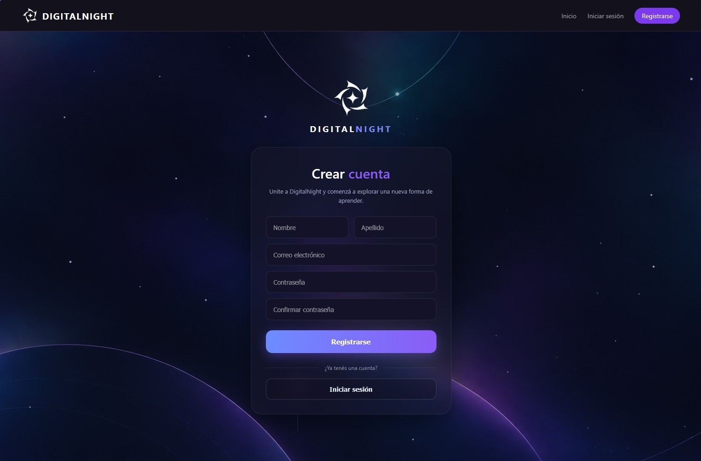

**Posibles errores:**
* **"El email ya está registrado"**: Ya existe una cuenta con ese correo. Usá otro email o iniciá sesión.
* **"La contraseña debe tener al menos 8 caracteres"**: Ingresá una clave que cumpla con el largo mínimo exigido.
* **"Las contraseñas no coinciden"**: Verificá que ambos campos sean exactamente iguales.
* **"El email no es válido"**: Escribí una dirección con formato de correo real (ejemplo: `nombre@correo.com`).

---

### 2.2 Validaciones al registrarse e iniciar sesión

Antes de crear una cuenta o iniciar sesión, DigitalNight revisa que los datos ingresados cumplan con las reglas de seguridad. Si algo falla, la pantalla muestra una alerta que explica qué corregir.

**Qué se revisa al registrarse:**
1. **Nombre**: Es obligatorio.
2. **Email**: Debe tener formato de correo válido (con `@` y dominio, ej. `nombre@gmail.com`).
3. **Contraseña**: Debe tener **al menos 8 caracteres**.
4. **Email repetido**: No se puede registrar un email que ya existe en la base de datos.

**Qué se revisa al iniciar sesión:**
1. **Email**: Formato de correo válido.
2. **Contraseña**: No puede quedar vacía.
3. Si el email y la clave no coinciden con una cuenta registrada, el acceso es denegado.

> **Seguridad:** Las contraseñas se almacenan encriptadas mediante hash (`bcrypt`); nadie, ni siquiera los administradores, puede ver la contraseña en texto plano.

---

### 2.3 Iniciar y cerrar sesión

Te permite ingresar a tu cuenta para acceder a tus contenidos personales o salir de forma segura al terminar.

**Pasos para Iniciar sesión:**
1. Hacé clic en **Iniciar sesión** en el menú de navegación (o entrá a `/login`).
2. Escribí tu **Correo electrónico** y tu **Contraseña**.
3. Opcional: Marcá la casilla **Recordarme** si estás en un equipo de confianza.
4. Hacé clic en el botón **Iniciar sesión**.
5. Al entrar, el menú superior se actualizará mostrando: *Mis juegos*, *Biblioteca*, *Editar perfil* (y *Panel admin* si sos administrador).

**Pasos para Cerrar sesión:**
1. Desde cualquier página donde te encuentres, hacé clic en el botón **Cerrar sesión** ubicado a la derecha del menú.
2. El sistema limpiará tus credenciales y token del navegador y te redirigirá al login.

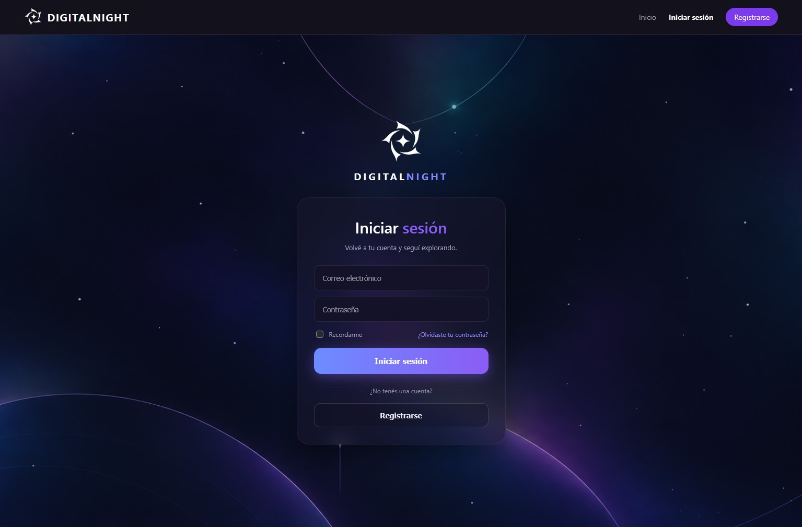

**Posibles errores:**
* **"Error: Correo o contraseña incorrectos."**: Las credenciales no coinciden con la base de datos.
* **"La contraseña es obligatoria"**: No dejes campos vacíos antes de enviar.

---

### 2.4 Límite de intentos y protección

Para proteger las cuentas ante ataques de fuerza bruta o saturación, DigitalNight limita cuántas peticiones se pueden realizar en un período de tiempo:

**Reglas de limitación:**
1. **Iniciar sesión** y **Recuperar contraseña**: Se permiten un máximo de **5 intentos por minuto**.
2. **Resto de la plataforma**: Se permiten hasta **100 acciones por minuto** por usuario.
3. Si superás este límite, el servidor responde con un error HTTP 429 y un aviso indicando cuántos segundos debés esperar.

**Posible error:**
* **"Demasiadas peticiones. Proba de nuevo en N segundos"**: Esperá los segundos indicados en el cartel antes de volver a intentar. No es necesario recargar ni cerrar el navegador.

---

### 2.5 Recuperar la contraseña

Permite restablecer tu clave si te la olvidaste mediante un enlace temporal seguro válido por **15 minutos**.

**Pasos:**
1. En la pantalla de login, hacé clic en **¿Olvidaste tu contraseña?** (o entrá a `/olvide-password`).
2. Escribí tu correo electrónico y presioná **Enviar enlace de recuperación**.
3. Verás el aviso: *"Si el email existe, te enviamos un enlace para restablecer tu contraseña"*.
4. **En entorno de desarrollo:** Abrí la terminal donde corre el backend (`api`); allí verás impreso el enlace generado:
   ```text
   Enlace de restablecimiento para usuario@ejemplo.com:
   http://localhost:5173/restablecer/eyJhbGciOi...
   ```
5. Copiá y abrí esa URL en tu navegador.
6. Escribí tu **Nueva contraseña** (mínimo 8 caracteres) y repetila en el segundo campo.
7. Hacé clic en **Restablecer contraseña**. El sistema actualizará tu clave y te enviará al login.

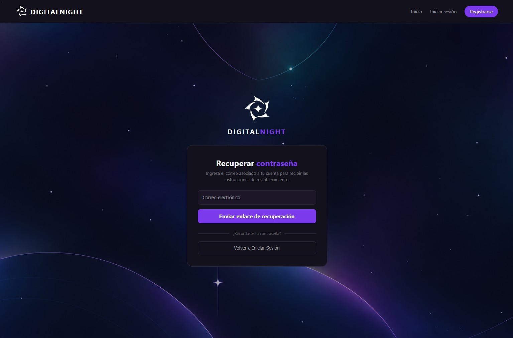

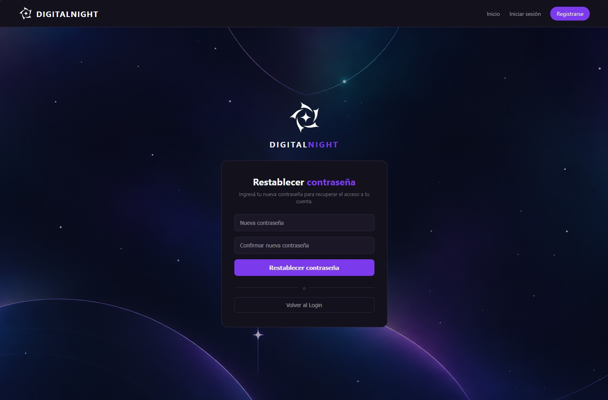

**Posibles errores:**
* **"El enlace no es válido o venció"**: Pasaron más de 15 minutos o el enlace se copió incompleto. Solicitá uno nuevo.
* **"Las contraseñas no coinciden"**: Los dos campos deben ser idénticos.
* **"La nueva contraseña debe tener al menos 8 caracteres"**: Ingresá una clave más larga.

---

### 2.6 Cambiar la contraseña desde tu perfil

Te permite actualizar tu contraseña cuando recordás la actual desde tu panel de configuración.

**Pasos:**
1. Iniciá sesión y entrá a **Editar perfil** en el menú de navegación.
2. En el menú lateral izquierdo, hacé clic en **Seguridad** (o visitá `/seguridad`).
3. Escribí tu **Contraseña actual**.
4. Escribí la **Nueva contraseña** (mínimo 8 caracteres) y confirmala en **Confirmar nueva contraseña**.
5. Hacé clic en **Guardar cambios**. Verás el mensaje verde *"Contraseña actualizada con éxito"*.
6. La próxima vez que inicies sesión, utilizá la nueva contraseña.


**Posibles errores:**
* **"La nueva contraseña y la confirmación no coinciden"**: Ambos campos deben coincidir.
* **"La contraseña actual es incorrecta"**: Verificá tu clave actual. Si la olvidaste, cerrá sesión y usá la opción de recuperación.
* **"La nueva contraseña debe tener al menos 8 caracteres"**: La clave debe cumplir con la longitud mínima.

---

## 3. Catálogo, Búsqueda y Detalle de Juegos

### 3.1 Catálogo y búsqueda

El catálogo permite explorar todos los videojuegos educativos aprobados en DigitalNight y encontrar uno específico mediante el buscador en tiempo real.

**Pasos:**
1. Desde la página de inicio, hacé clic en el botón **Explorar juegos** (o en **Juegos** en la barra superior).
2. En el catálogo vas a encontrar todos los títulos disponibles con su portada, materia, curso y valoración.
3. Para buscar por nombre, escribí el título en el campo de búsqueda superior.
4. El catálogo filtrará de inmediato los juegos que coincidan con el texto ingresado.
5. Para consultar la ficha completa de un juego, hacé clic sobre su tarjeta.

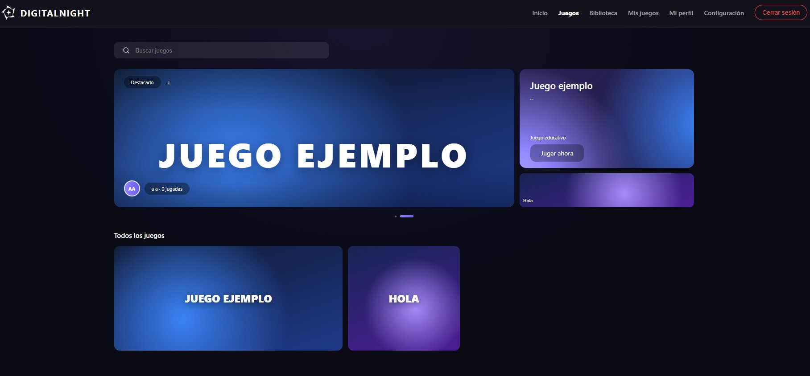

**Posibles errores:**
* **No aparecen resultados**: Ningún juego coincide con el término buscado. Probá con una sola palabra o limpiá el buscador.
* **No se muestra la portada**: El juego no posee imagen cargada o la ruta no pudo resolverse en el servidor.

---

### 3.2 Ver el detalle de un juego

Muestra la información completa de una publicación: temática, autor, capturas de pantalla, archivos y estadísticas. No requiere haber iniciado sesión para visualizarlo.

**Pasos:**
1. Ingresá al catálogo de **Juegos** y hacé clic en cualquier tarjeta.
2. En la cabecera verás el título, etiquetas (plataforma, materia y curso), descripción, autor y valoración promedio.
3. En el cuerpo principal encontrarás la sección "Sobre el juego", las **capturas** (al hacer clic en una se abre en tamaño completo) y la ficha técnica.
4. En la columna derecha figuran las métricas: **Jugadas**, **Favoritos** y **Nota promedio**.
5. Para conocer más creaciones del desarrollador, hacé clic sobre su nombre o en el botón **Ver perfil**.


**Avisos informativos en la ficha:**
* **"Este juego está en revisión"** (amarillo): Visible únicamente para el autor o los administradores mientras espera aprobación.
* **"Este juego fue rechazado"** (rojo): Muestra el motivo redactado por el moderador para que el autor pueda corregirlo.

**Posibles errores:**
* **"Juego no encontrado"**: El juego fue eliminado, no está aprobado o el enlace es incorrecto.
* **"Sin valoraciones todavía"**: Mensaje informativo cuando nadie ha votado aún.
* **"Este juego todavía no tiene capturas"**: El autor no adjuntó imágenes de muestra.

---

### 3.3 Jugar, guardar en favoritos y compartir

Son los tres botones de interacción principal ubicados debajo de la descripción:

**Funcionalidades:**
1. **Jugar ahora**: Abre el juego en una nueva pestaña y suma una jugada al contador. Si tenés la sesión iniciada, quedará registrado en tu Biblioteca en "Jugados recientemente".
2. **Guardar**: Añade el título a tus favoritos personales. El botón se vuelve violeta y cambia su texto a **Guardado**. Al tocarlo nuevamente, se remueve.
3. **Compartir**: Copia la URL directa de la publicación al portapapeles para compartirla por cualquier canal.

**Posibles errores:**
* **"Tenés que iniciar sesión para guardar juegos en favoritos"**: Se requiere cuenta activa para guardar favoritos.
* **"Este juego todavía no tiene un link ni un archivo para jugar"**: El autor no especificó un enlace externo ni subió un ejecutable.
* **"No se pudo copiar"**: Si tu navegador restringe el portapapeles, copiá la URL directamente desde la barra de direcciones.

---

## 4. Biblioteca Personal

### 4.1 Uso de la Biblioteca: Favoritos e Historial

Espacio personal donde se almacenan tus juegos guardados y el registro de tu actividad reciente. Requiere haber iniciado sesión.

**Pasos:**
1. Iniciá sesión y hacé clic en **Biblioteca** en el menú superior (o visitá `/biblioteca`).
2. En la pestaña **Favoritos** verás todas las publicaciones que guardaste, ordenadas desde la más reciente. El número entre paréntesis indica la cantidad total.
3. En la pestaña **Jugados recientemente** se listan los últimos 12 juegos que abriste con "Jugar ahora", junto a la fecha en que los jugaste.
4. Hacé clic en cualquier tarjeta para abrir la ficha de detalle de ese juego.


**Posibles errores:**
* **"Primero debes iniciar sesión"**: Serás redirigido al login si intentás ingresar sin autenticarte.
* **"Todavía no guardaste ningún juego"**: Aviso informativo que indica que tu lista de favoritos está vacía.
* **"No se pudo cargar tu biblioteca"**: Fallo temporal de conexión con el backend; recargá la página.
* Si un juego que guardaste desaparece de tu biblioteca, significa que su autor o un administrador lo eliminó.

---

## 5. Creación y Gestión de Videojuegos

### 5.1 Crear y publicar un juego

Permite subir un juego propio a DigitalNight para compartirlo con la comunidad escolar. Al crearlo queda en estado **"En revisión"** hasta que un administrador lo verifique (si lo crea un admin, se publica de forma directa).

**Pasos:**
1. Iniciá sesión y entrá a **Mis juegos** desde el menú.
2. Hacé clic en **+ Crear videojuego** para abrir el formulario.
3. Completá los campos requeridos:
   * **Título del juego** y **Descripción** (obligatorios).
   * **Link para jugar** (opcional): Enlace a la versión web externa (ej. itch.io, Scratch).
   * **Materia**: Matemática, Lengua, Ciencias naturales, Historia, Programación u Otra.
   * **Curso**: De 1° a 6° año.
4. Subí la portada, las capturas y el archivo del juego (según la guía de la sección 5.2).
5. Hacé clic en **Crear videojuego →**. Verás el mensaje *"¡Juego creado correctamente!"* y aparecerá en **Mis juegos** con la etiqueta amarilla "En revisión".


**Posibles errores:**

| Mensaje | Causa | Qué hacer |
|---|---|---|
| "Completá el título y la descripción." | Se dejó alguno de los campos obligatorios en blanco | Completalos y volvé a guardar |
| "No se pudo guardar el juego." | Falló la comunicación con el servidor | Verificá tu conexión e intentá nuevamente |
| Redirección al login | La sesión caducó | Volvé a iniciar sesión |

---

### 5.2 Subir portada, capturas y archivo del juego

Permite asignarle una imagen principal, capturas de pantalla y el archivo comprimido o ejecutable web a tu publicación.

**Formatos y tamaños permitidos:**

| Archivo | Cantidad | Formatos permitidos | Tamaño máximo |
|---|---|---|---|
| **Portada** | 1 | PNG o JPG (recomendado 1280×720) | 50 MB |
| **Capturas** | Hasta 3 | PNG o JPG | 50 MB cada una |
| **Archivo del juego** | 1 | .zip, .rar, .7z o .html | 50 MB |

**Pasos:**
1. En el formulario, ubicá la sección **Archivos del juego**.
2. Hacé clic en el recuadro de la **Portada** y elegí tu archivo.
3. Hacé clic en los recuadros de **Capturas** y subí hasta 3 imágenes ilustrativas.
4. Hacé clic en el recuadro del **Archivo del juego** y seleccioná el comprimido o HTML.
5. Cuando un archivo se cargó correctamente, el recuadro cambia el ícono `+` por una tilde verde `✓`.
6. Si necesitás corregir algún archivo, hacé clic nuevamente sobre el recuadro para reemplazarlo.


**Posibles errores:**

| Mensaje | Causa | Qué hacer |
|---|---|---|
| "*nombre* no es PNG ni JPG." | Se seleccionó un formato no soportado (ej. GIF o WebP) | Convertí la imagen a PNG o JPG |
| "*nombre* supera los 50 MB." | El archivo excede el tamaño máximo permitido | Comprimilo o reducí la resolución |
| "El archivo del juego debe ser .zip, .rar, .7z o .html." | El archivo tiene otra extensión | Comprimí el proyecto en un archivo `.zip` |
| "Podés subir 1 portada, hasta 3 capturas y 1 archivo del juego" | Se intentó enviar más archivos de los permitidos | Respetá las cantidades máximas |

---

### 5.3 Estados del juego y flujo de moderación

Para garantizar la calidad pedagógica y la convivencia escolar, todos los títulos atraviesan tres posibles estados:

* **En revisión (`pendiente`):** Estado inicial asignado al crear o editar un juego (a excepción de los creados por un admin). Es visible únicamente para su autor y el equipo de administración. No figura en el catálogo público (`GET /games`).
* **Publicado (`publicado`):** Aprobado por un administrador. Es visible para toda la comunidad en el catálogo, buscador y perfiles.
* **Rechazado (`rechazado`):** Si un administrador considera que el juego incumple normas o requiere mejoras técnicas, lo rechaza ingresando un **motivo obligatorio**. El autor puede leer la observación en "Mis juegos", corregir los archivos o datos y reenviarlo a revisión al guardar.

> **Regla de re-moderación:** Siempre que un autor edita un juego publicado o rechazado, vuelve automáticamente al estado **En revisión** para una nueva verificación de los administradores.

---

### 5.4 Mis creaciones y edición

Panel accesible desde `/mis-juegos` para los desarrolladores de la plataforma.

**Características:**
* **Métricas superiores:** Contadores en tiempo real de títulos **Publicados**, **En revisión** y **Rechazados**.
* **Listado de títulos:** Muestra la portada, título, descripción, fecha de actualización y etiqueta de estado con sus colores (Verde: Publicado, Amarillo: En revisión, Rojo: Rechazado con el motivo detallado).

**Pasos para editar un juego:**
1. Entrá a **Mis juegos** desde el menú.
2. En la tarjeta del juego que querés modificar, hacé clic en el botón circular **✎**.
3. Se abrirá la pantalla **Editar videojuego** con todos los datos previamente guardados.
4. Realizá los cambios necesarios (si no subís imágenes nuevas, se mantendrán las actuales).
5. Hacé clic en **Guardar cambios →**. Verás el mensaje *"¡Juego actualizado correctamente!"* y volverá a revisión.


**Posibles errores:**

| Mensaje | Causa | Qué hacer |
|---|---|---|
| "No se pudo cargar el juego." | El juego no existe o pertenece a otro usuario | Regresá a Mis juegos |
| "Completá el título y la descripción." | Se borró un campo obligatorio | Completalos antes de guardar |
| Errores de archivos | Formato o tamaño excedido | Revisá las especificaciones de la sección 5.2 |

---

### 5.5 Eliminar un juego

Quita definitivamente un juego propio de DigitalNight junto a sus valoraciones, favoritos y registros asociados.

> **Atención:** Esta acción es permanente y no se puede deshacer.

**Pasos:**
1. Ingresá a **Mis juegos**.
2. En la publicación que deseás borrar, hacé clic en el botón **×**.
3. El navegador te solicitará confirmación: *"¿Seguro que querés eliminar este juego? Esta acción no se puede deshacer."*
4. Hacé clic en **Aceptar** para confirmar la baja definitiva, o en **Cancelar** para conservarlo.


**Posible error:**

| Mensaje | Causa | Qué hacer |
|---|---|---|
| "No se pudo eliminar el juego." | Falló la red o la sesión caducó | Recargá la página, reanudá sesión e intentá de nuevo |

---

## 6. Perfiles y Privacidad

### 6.1 Mi perfil y perfiles públicos

Desde tu perfil podés consultar tu información y tus títulos publicados. También podés visitar los perfiles de otros miembros de la comunidad escolar.

**Pasos para ver tu perfil:**
1. Iniciá sesión en DigitalNight.
2. Hacé clic en **Mi perfil** en la barra de navegación (o entrá a `/perfil`).
3. Allí podrás ver tu nombre, biografía, fecha de registro y lista de juegos propios.

**Pasos para ver un perfil público:**
1. Hacé clic sobre el nombre del autor en cualquier publicación o juego del catálogo.
2. Accederás a su vista pública (`/perfil/:id`).
3. Si el usuario cuenta con juegos publicados, verás el contador y la grilla de títulos.
4. Los usuarios que hayan creado juegos aprobados aparecerán con el distintivo de creador **✓**.

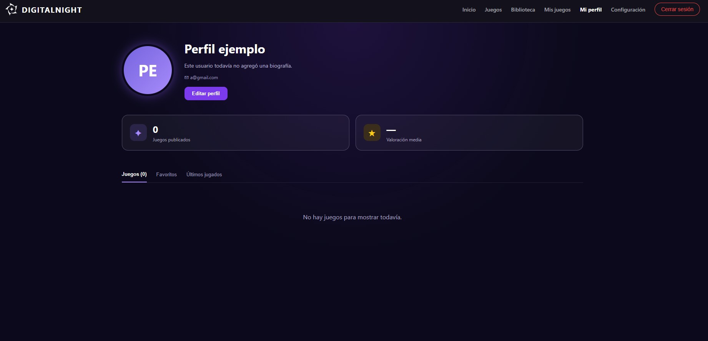

**Posibles errores:**
* **No se puede abrir un perfil**: El usuario no existe o el enlace está mal escrito.
* **No se visualiza cierta información**: El usuario configuró esos campos como privados.

---

### 6.2 Editar datos y biografía

Permite actualizar la información personal que se muestra en tu perfil escolar.

**Pasos:**
1. Iniciá sesión y entrá a **Editar perfil** en la barra superior.
2. Modificá tu **Nombre**, **Apellido** o **Fecha de nacimiento**.
3. En el campo **Biografía**, escribí una breve descripción personal o académica.
4. Hacé clic en **Guardar cambios**. Verás el aviso *"Perfil actualizado correctamente."*

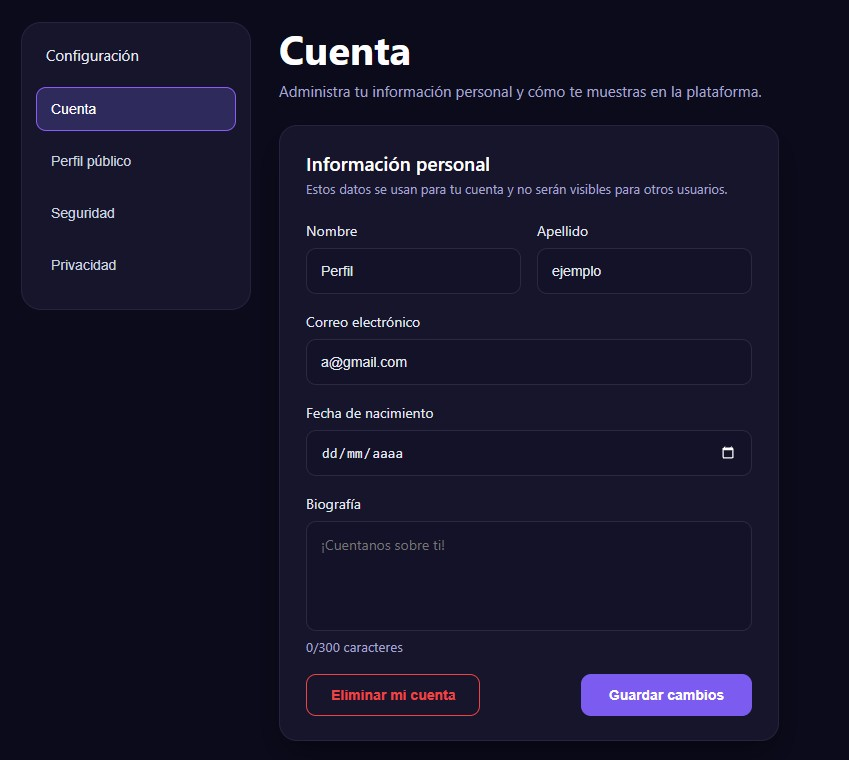

**Posibles errores:**
* **No se guardan los cambios**: Verificá que los campos requeridos no hayan quedado vacíos.
* **No se actualiza el perfil**: Recargá la página para refrescar la memoria del navegador.

---

### 6.3 Cambiar el email desde Editar perfil

Desde **Editar perfil** también podés actualizar la dirección de correo electrónico vinculada a tu cuenta.

**Pasos:**
1. Entrá a **Editar perfil**.
2. Escribí el nuevo correo en el campo de email.
3. Hacé clic en guardar. El servidor comprobará que el formato sea válido y que ninguna otra cuenta lo esté utilizando.
4. Si todo es correcto, aparecerá *"Perfil actualizado correctamente."*

**Posibles errores:**
* **"El email no es válido"**: Revisá que contenga `@` y una extensión válida.
* **"Ese email ya está en uso"**: Otra cuenta ya está registrada con esa dirección.

---

### 6.4 Ajustes de privacidad y eliminar la cuenta

Permite elegir qué datos personales son visibles para el resto de la comunidad o dar de baja tu usuario de forma definitiva.

**Pasos para configurar la privacidad:**
1. Iniciá sesión y entrá a **Editar perfil**.
2. En el menú lateral, hacé clic en **Privacidad** (o visitá `/privacidad`).
3. Configurá las casillas de visibilidad para tu perfil, tu email y tu fecha de nacimiento.
4. Hacé clic en **Guardar cambios** para aplicar la configuración.

**Pasos para eliminar la cuenta:**
1. En la misma pantalla de **Privacidad**, buscá el botón rojo **Eliminar cuenta**.
2. Leé atentamente el aviso de advertencia.
3. Confirmá la acción si estás seguro de que querés borrar tu cuenta y todo tu contenido asociado de la plataforma.

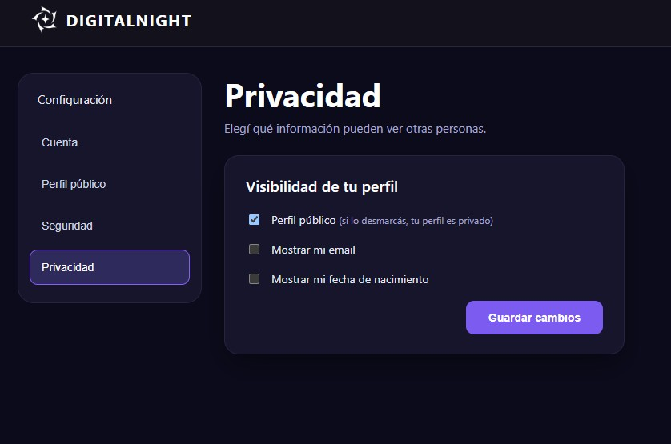

**Posibles errores:**
* **No podés acceder a privacidad**: Asegurate de tener una sesión activa.
* **No se puede eliminar la cuenta**: Verificá tu conexión y completá la confirmación solicitada en la ventana emergente.

---

## 7. Panel de Administración y Moderación

Módulo exclusivo para usuarios con rol `admin`, accesible desde la ruta `/admin` o el enlace **Panel admin** del menú superior.

### 7.1 Gestión y moderación de usuarios

Permite supervisar el padrón general de usuarios registrados:
* **Listado de cuentas:** Visualización de ID, nombre completo, email y rol (`user` o `admin`).
* **Crear usuarios:** Formulario para dar de alta nuevas cuentas asignando roles predeterminados (`POST /admin/users`).
* **Editar usuarios:** Modificación de datos personales y promoción a rol administrador (`PUT /users/:id`).
* **Eliminar usuarios:** Borrado permanente de cuentas que hayan incumplido las normas (`DELETE /users/:id`).

---

### 7.2 Revisión y aprobación de juegos

Submódulo de moderación dividido en dos pestañas:

1. **Pestaña "Revisión de juegos":**
   * Centraliza los títulos pendientes de moderación (`GET /admin/games?status=pendiente`).
   * Muestra la portada, título, autor y datos escolares.
   * **Ver juego:** Permite inspeccionar la ficha, capturas y archivos en una pestaña nueva.
   * **Aprobar:** Cambia el estado a `publicado` y lo hace visible en el catálogo de inmediato (`PUT /admin/games/:id/review` con `{ status: 'publicado' }`).
   * **Rechazar:** Abre un cuadro de diálogo que exige ingresar un **motivo obligatorio** de rechazo pedagógico o técnico (ej. *"Falta enlace funcional"* o *"Imágenes inapropiadas"*). El autor recibirá la notificación para corregirlo.

2. **Pestaña "Todos los juegos":**
   * Permite inspeccionar el catálogo global histórico (`GET /admin/games`).
   * Facilita al administrador la eliminación definitiva de cualquier publicación con el botón **Eliminar** en caso de faltas graves (`DELETE /games/:id`).

---

### 7.3 Panel de auditoría (solo administradores)

Registra cada acción enviada a la API backend: qué usuario la solicitó, hacia qué ruta, fecha, hora y resultado técnico. Es una herramienta clave para diagnosticar errores y prevenir abusos.

**Pasos:**
1. Iniciá sesión como administrador y entrá a **Panel admin**.
2. Hacé clic en el botón **Ver auditoría**.
3. Se abrirá la pantalla **"Auditoría - Últimas 100 peticiones a la API"** con las acciones más recientes ordenadas arriba.
4. Para regresar, hacé clic en **Volver al panel**.

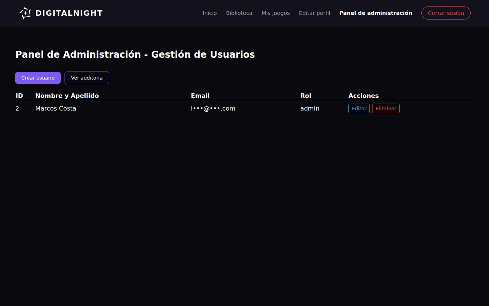

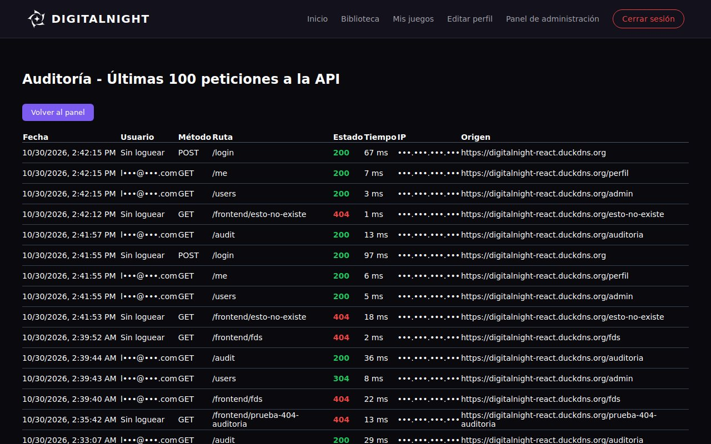

**Columnas del registro de auditoría:**
* **Fecha:** Día y horario exacto de la petición.
* **Usuario:** Email del usuario autenticado, o *"Sin loguear"* si fue una acción anónima.
* **Método:** Tipo de operación HTTP (`GET`, `POST`, `PUT`, `DELETE`).
* **Ruta:** Endpoint solicitado (ej. `/games/5`). Las rutas que inician con `/frontend/` registran visitas a páginas 404.
* **Estado:** Código numérico y color de respuesta:
  * **Verde (200/201):** Operación exitosa.
  * **Naranja (429):** Bloqueo por exceso de peticiones.
  * **Rojo (400/401/403/404/500):** Error en la petición.
* **Tiempo:** Milisegundos que tardó el servidor en procesar la respuesta.
* **IP:** Dirección de conexión del cliente.
* **Origen:** Página previa desde la cual se ejecutó la acción.

**Posibles errores:**
* **"No tienes permisos de administrador para ver esta sección."**: Tu usuario no cuenta con rol de administrador.
* **Redirección al login**: La sesión de administración expiró (vigencia de 8 horas).

---

## 8. Página no encontrada (404)

### 8.1 Visualización y registro de errores 404

Si un usuario escribe una dirección que no existe en DigitalNight o accede desde un enlace desactualizado, el sistema despliega una pantalla personalizada en lugar de un error en blanco.

**Qué vas a ver:**
1. Una ilustración central con el número **404** en violeta y la leyenda **"Página no encontrada"**.
2. Un botón directo **Volver al inicio** para reanudar la navegación fácilmente.

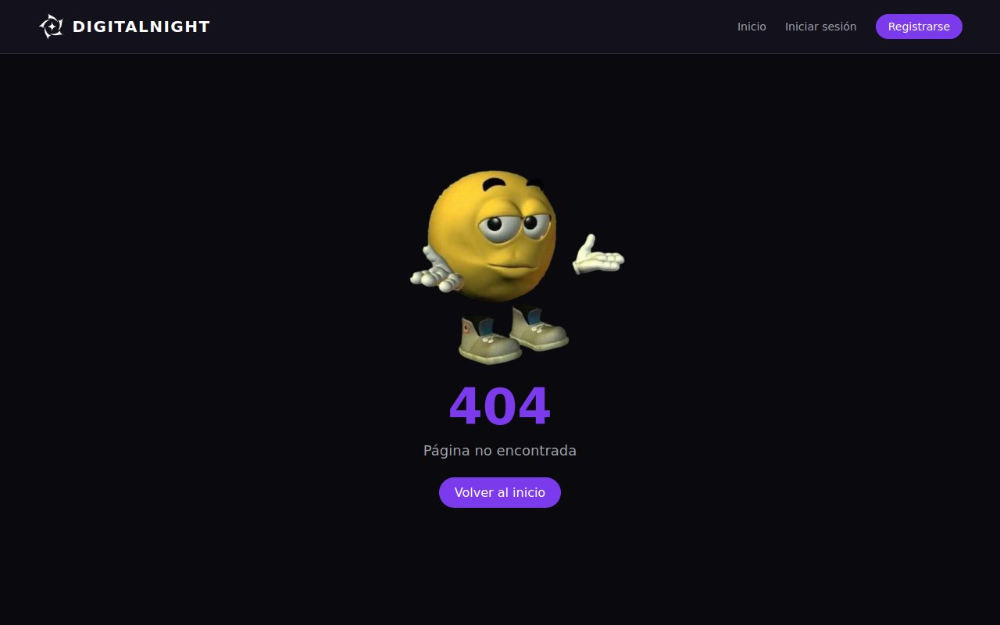

> **Auditoría automática:** Toda visita a una ruta inexistente se envía automáticamente al backend para quedar registrada en la tabla de auditoría, permitiendo al equipo administrativo detectar y reparar enlaces rotos.

---

## 9. Guía de Errores Comunes y Soluciones

### 9.1 Tabla de códigos de estado HTTP

Cuando una acción no puede completarse, el backend devuelve un código de estado junto a una explicación. La siguiente tabla resume las situaciones más habituales y cómo resolverlas:

| Código | Qué significa | Mensajes habituales | Qué hacer |
|---|---|---|---|
| **400** | Datos faltantes o inválidos | "El email no es válido", "La contraseña debe tener al menos 8 caracteres", "Ese email ya está en uso", "Usuario o contraseña incorrecta", "Petición inválida" | Revisá el mensaje, corregí el campo indicado en el formulario y volvé a guardar. |
| **401** | Sin sesión o sesión expirada | "No autenticado", "Token no proporcionado", "Error al acceder" | Iniciá sesión nuevamente. Las sesiones duran 8 horas. |
| **403** | Permisos insuficientes | "Acceso denegado", "No tienes permiso para esta acción", "Este juego no está disponible o se encuentra en revisión" | La acción está reservada a administradores o al autor del juego. Si el juego está en revisión, aguardá a su moderación. |
| **404** | Recurso no encontrado | "Juego no encontrado", "Usuario no encontrado", "Ruta no encontrada", página 404 | Verificá el link ingresado. El recurso pudo haber sido eliminado. |
| **409** | Conflicto de datos | "El email ya está registrado" | Utilizá una dirección de correo alternativa o iniciá sesión. |
| **429** | Límite de intentos superado | "Demasiadas peticiones. Proba de nuevo en N segundos" | Esperá los segundos indicados por el servidor sin necesidad de recargar. |
| **500** | Error interno del servidor | "Error interno del servidor", "Error al registrar el usuario", "Error al iniciar sesión" | Aguardá unos minutos y reintentá. Si persiste, notificá al equipo técnico. |

### 9.2 Diagnóstico si la página no carga
* Comprobá tu conexión a internet o a la red escolar.
* Si ejecutás el proyecto en entorno de desarrollo local, asegurate de que el backend (`api/`) esté activo en el puerto 3000 y que el servicio de MySQL (vía XAMPP o terminal) esté encendido.
