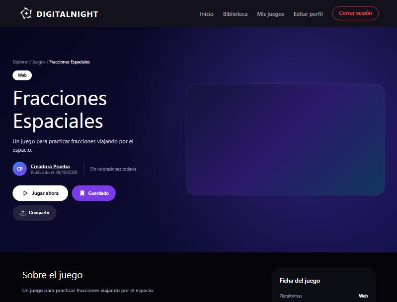
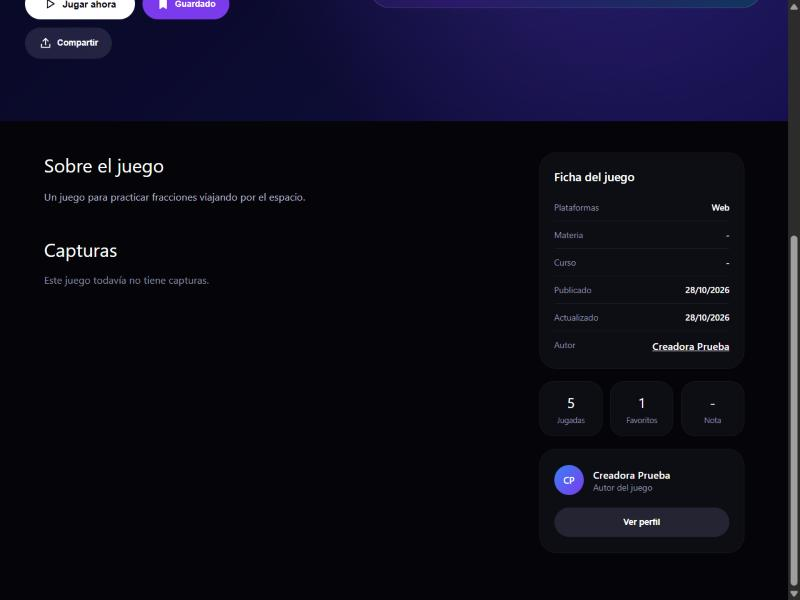
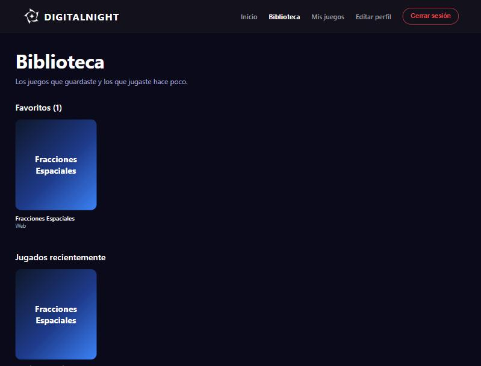
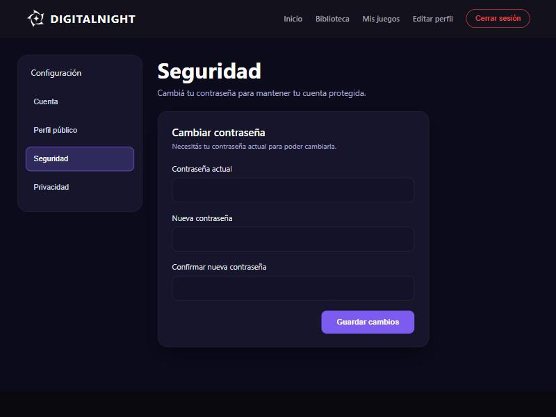

# Manual de usuario: secciones de Amy

## Ver el detalle de un juego

Muestra toda la información de un juego: de qué se trata, quién lo hizo, sus capturas y sus estadísticas. No hace falta iniciar sesión para verlo.

**Pasos**
1. Entrá a **Juegos** desde el botón "Explorar juegos" de la pantalla de inicio.
2. Hacé clic en cualquier juego del catálogo.
3. Arriba vas a ver el título, las etiquetas (plataforma, materia y curso), la descripción, el autor y la valoración promedio.
4. Más abajo vas a ver "Sobre el juego", las **capturas** (si hacés clic en una se abre en grande) y la **Ficha del juego**.
5. En la columna de la derecha están las estadísticas: **Jugadas**, **Favoritos** y **Nota**.
6. Para ver el perfil de quien creó el juego, hacé clic en su nombre o en el botón **Ver perfil**.

**Avisos que podés ver**
- **"Este juego está en revisión"** (amarillo): solo lo ve el autor o un administrador. El juego todavía no aparece en el catálogo hasta que un administrador lo apruebe.
- **"Este juego fue rechazado"** (rojo): aparece junto con el motivo que escribió el administrador.

**Posibles errores**
- **"Juego no encontrado"**: el juego fue borrado, todavía no fue aprobado o el link está mal. Volvé al catálogo y buscalo de nuevo.
- **"Sin valoraciones todavía"**: no es un error, significa que nadie lo valoró aún.
- **"Este juego todavía no tiene capturas"**: el autor no subió imágenes.

---

## Jugar, guardar en favoritos y compartir

Son los tres botones que están debajo de la descripción del juego.

**Pasos**
1. **Jugar ahora**: abre el juego en una pestaña nueva y suma una jugada al contador. Si iniciaste sesión, el juego también aparece en tu **Biblioteca**, en "Jugados recientemente".
2. **Guardar**: agrega el juego a tus favoritos. El botón se pone violeta y cambia a **Guardado**. Si lo tocás de nuevo, se quita de favoritos.
3. **Compartir**: copia el link del juego. Después lo podés pegar donde quieras (WhatsApp, mail, etc.).

**Posibles errores**
- **"Tenés que iniciar sesión para guardar juegos en favoritos"**: el botón Guardar solo funciona con una sesión iniciada. Te lleva a la pantalla de inicio de sesión.
- **"Este juego todavía no tiene un link ni un archivo para jugar"**: el autor no cargó cómo jugarlo. La jugada se cuenta igual.
- **"No se pudo copiar"**: algunos navegadores no dejan copiar automáticamente. Copiá el link desde la barra de direcciones.
- Si el juego no se abre al tocar **Jugar ahora**, revisá que el navegador no esté bloqueando las ventanas emergentes.

---

## Biblioteca

Es tu espacio personal con los juegos que guardaste y los que jugaste hace poco. Necesitás iniciar sesión.

**Pasos**
1. Iniciá sesión.
2. Hacé clic en **Biblioteca** en el menú de arriba.
3. En **Favoritos** aparecen los juegos que guardaste, primero el último que agregaste. El número entre paréntesis indica cuántos tenés.
4. En **Jugados recientemente** aparecen los últimos 12 juegos que abriste con "Jugar ahora", con la fecha en que los jugaste.
5. Hacé clic en cualquier tarjeta para ir al detalle de ese juego.

**Posibles errores**
- **"Primero debes iniciar sesión"**: entraste sin una sesión iniciada. Te lleva a la pantalla de inicio de sesión.
- **"Todavía no guardaste ningún juego"**: no es un error. Tocá **Explorar juegos** y guardá alguno.
- **"No se pudo cargar tu biblioteca"**: el servidor no responde. Esperá un momento y recargá la página.
- Si un juego que guardaste desaparece de la Biblioteca, es porque su autor o un administrador lo borró.

---

## Cambiar la contraseña

Te permite poner una contraseña nueva. Necesitás saber la actual.

**Pasos**
1. Iniciá sesión y entrá a **Editar perfil** en el menú de arriba.
2. En el menú de la izquierda, hacé clic en **Seguridad**.
3. Escribí tu **contraseña actual**.
4. Escribí la **nueva contraseña** (mínimo 8 caracteres) y repetila en **Confirmar nueva contraseña**.
5. Hacé clic en **Guardar cambios**. Si salió bien, vas a ver el mensaje verde "Contraseña actualizada con éxito".
6. La próxima vez que inicies sesión, usá la contraseña nueva.

**Posibles errores**
- **"La nueva contraseña y la confirmación no coinciden"**: los dos últimos campos tienen que ser iguales.
- **"La contraseña actual es incorrecta"**: revisá la contraseña actual. Si no te la acordás, cerrá sesión y usá **¿Olvidaste tu contraseña?** en la pantalla de inicio de sesión.
- **"La nueva contraseña debe tener al menos 8 caracteres"**: elegí una contraseña más larga.
