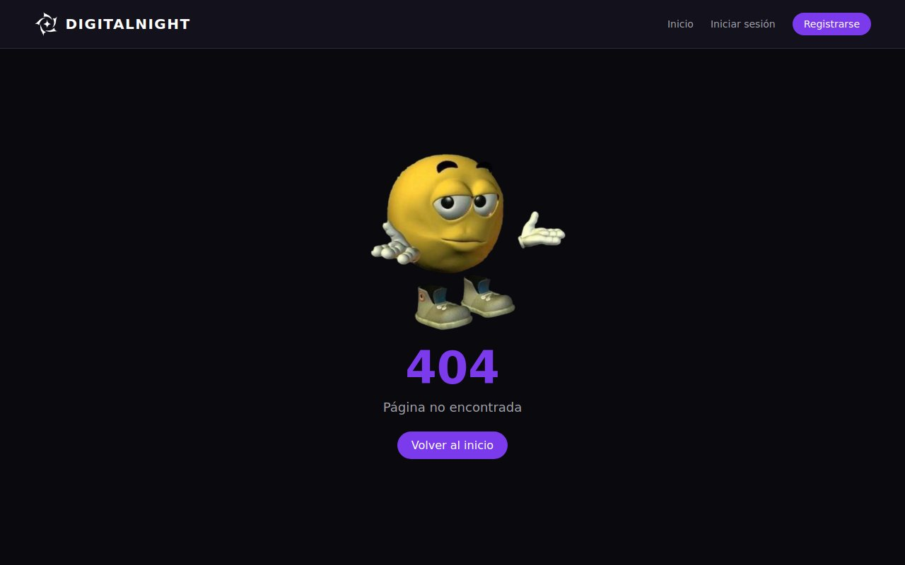
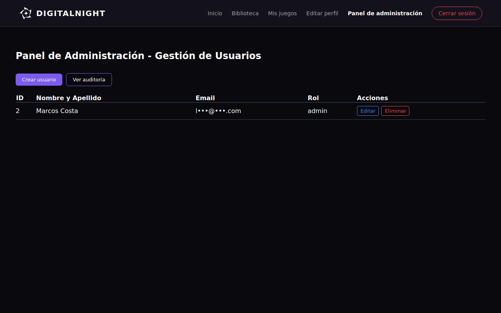
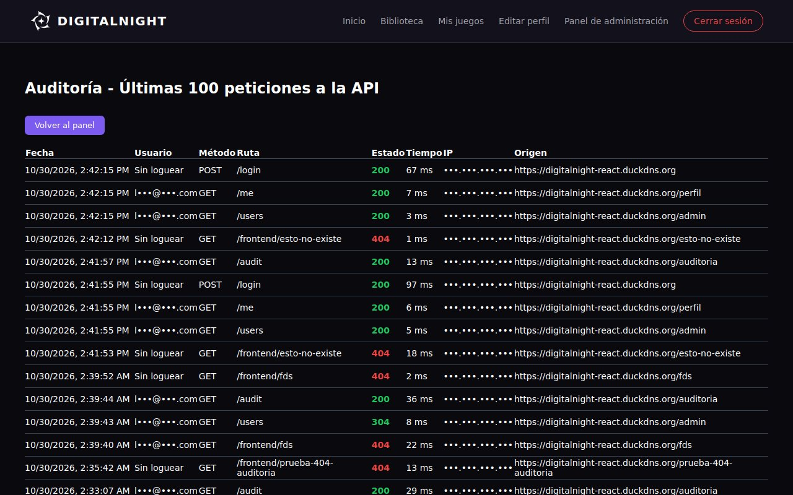

# Manual de usuario: secciones de Luciano

## Validaciones al registrarse e iniciar sesión

Antes de crear una cuenta o iniciar sesión, DigitalNight revisa que los datos estén bien escritos. Si algo falla, la pantalla muestra un cartel que explica qué corregir.

**Qué se revisa al registrarse**
1. **Nombre**: es obligatorio.
2. **Email**: tiene que tener formato de email (por ejemplo, `nombre@gmail.com`).
3. **Contraseña**: tiene que tener **al menos 8 caracteres**.
4. **Email repetido**: no se puede crear una cuenta con un email que ya está registrado.

**Qué se revisa al iniciar sesión**
1. **Email**: tiene que tener formato de email.
2. **Contraseña**: no puede quedar vacía.
3. Si el email y la contraseña no coinciden con una cuenta, no se puede entrar.

> Por seguridad, las contraseñas se guardan encriptadas: nadie, ni siquiera un administrador, puede ver la contraseña real de un usuario.

**Posibles errores**
- **"El nombre es obligatorio"**: completá el campo Nombre.
- **"El email no es válido"**: revisá que el email tenga `@` y un dominio (por ejemplo, `.com`).
- **"La contraseña debe tener al menos 8 caracteres"**: elegí una contraseña más larga.
- **"El email ya está registrado"**: ya existe una cuenta con ese email. Iniciá sesión o usá **¿Olvidaste tu contraseña?**.
- **"La contraseña es obligatoria"**: escribí tu contraseña antes de presionar Ingresar.
- **"Error: Correo o contraseña incorrectos."**: revisá que el email y la contraseña estén bien escritos (las mayúsculas cuentan).

---

## Límite de intentos

Para proteger las cuentas, DigitalNight limita cuántas veces se puede intentar algo en poco tiempo. Así nadie puede probar contraseñas una y otra vez hasta adivinar una.

**Cómo funciona**
1. **Iniciar sesión** y **Olvidé mi contraseña**: se permiten **5 intentos por minuto**.
2. **El resto de la página**: se permiten **100 acciones por minuto**. Usándola normalmente nunca se llega a ese número.
3. Si te pasás del límite, aparece un cartel que dice cuántos segundos tenés que esperar.
4. Cuando pasa ese tiempo, podés volver a intentar normalmente.

**Posibles errores**
- **"Demasiadas peticiones. Proba de nuevo en N segundos"**: hiciste demasiados intentos seguidos. Esperá los segundos que indica el cartel y volvé a probar. No hace falta recargar la página ni cerrar el navegador.

---

## Cambiar el email desde Editar perfil

Desde **Editar perfil** podés cambiar el email de tu cuenta. Antes de guardarlo, DigitalNight revisa que esté bien escrito y que no lo use otra persona.

**Pasos**
1. Iniciá sesión en DigitalNight.
2. Entrá a **Editar perfil** desde el menú de navegación.
3. Escribí el nuevo email en el campo correspondiente.
4. Guardá los cambios. Si todo está bien, aparece el cartel **"Perfil actualizado correctamente."**

> Si solo cambiás otros datos (nombre, biografía, etc.) y dejás tu mismo email, se guarda sin problema.

**Posibles errores**
- **"El email no es válido"**: revisá que el email esté bien escrito.
- **"Ese email ya está en uso"**: otra cuenta ya usa ese email. Elegí uno distinto.

---

## Página no encontrada (404)

Si escribís una dirección que no existe dentro de DigitalNight (por ejemplo, un link mal copiado), se muestra una pantalla especial en lugar de una página vacía.

**Qué vas a ver**
1. Una imagen en el centro, el número **404** en violeta y el mensaje **"Página no encontrada"**.
2. Un botón **Volver al inicio** que te lleva a la pantalla principal.

**Qué hacer**
- Revisá que la dirección esté bien escrita.
- Si llegaste desde un link, puede que la página haya sido borrada o movida. Volvé al inicio y buscala desde el menú.

> Las visitas a direcciones que no existen quedan registradas en la **Auditoría** (ver la sección siguiente), para que un administrador pueda detectar links rotos.

---

## Panel de auditoría (solo administradores)

La auditoría guarda un registro de cada acción que llega al servidor: quién la hizo, a qué parte de la página, cuándo y cómo le fue. Sirve para detectar errores y usos sospechosos, como alguien que prueba muchas contraseñas.

**Pasos**
1. Iniciá sesión con una cuenta de administrador.
2. Entrá al **Panel admin** desde la barra superior.
3. Hacé clic en el botón **Ver auditoría**.
4. Se abre la pantalla **"Auditoría - Últimas 100 peticiones a la API"**, con las acciones más nuevas arriba.
5. Para volver, hacé clic en **Volver al panel**.

**Columnas de la tabla**
- **Fecha**: día y hora de la acción.
- **Usuario**: el email de quien la hizo, o **"Sin loguear"** si no había iniciado sesión.
- **Método**: el tipo de acción (`GET` consultar, `POST` crear, `PUT` modificar, `DELETE` borrar).
- **Ruta**: a qué parte se pidió (por ejemplo, `/games/5`). Las que empiezan con `/frontend/` son visitas a la página 404.
- **Estado**: el resultado, con colores:
  - **Verde**: salió bien.
  - **Naranja** (`429`): bloqueado por el límite de intentos.
  - **Rojo**: hubo un error (ver la guía de errores más abajo).
- **Tiempo**: cuántos milisegundos tardó el servidor en responder.
- **IP**: la dirección de la conexión de quien hizo la acción.
- **Origen**: desde qué página se hizo, o **"-"** si no se sabe.

**Filtros**

Arriba de la tabla hay tres filtros que se pueden combinar:
1. **Buscar por usuario o ruta**: escribí parte de un email o de una ruta (por ejemplo, `login`).
2. **Método**: mostrá solo `GET`, `POST`, `PUT` o `DELETE`.
3. **Estado**: un código en particular. Cada uno significa algo distinto (ver la tabla de abajo).

| Código | Qué significa |
|---|---|
| **200** OK | Salió bien |
| **201** Creado | Se creó algo nuevo (por ejemplo, una cuenta) |
| **304** Sin cambios | El navegador ya tenía esos datos guardados y no hizo falta mandarlos de nuevo |
| **400** Datos inválidos | Algún dato estaba mal escrito o faltaba |
| **401** Sin sesión | No había sesión iniciada o venció |
| **403** Sin permiso | Había sesión, pero no tenía permiso (por ejemplo, no es administrador) |
| **404** No encontrado | Lo pedido no existe |
| **409** Ya existe | Choca con algo que ya existe (por ejemplo, un email repetido) |
| **429** Demasiadas peticiones | Bloqueado por el límite de intentos |
| **500** Error del servidor | Falló algo del lado del servidor |

Abajo de los filtros dice **"Mostrando X de Y"**: cuántas filas quedaron sobre el total. Los filtros buscan dentro de las últimas 100 acciones.

**Posibles errores**
- **"No tienes permisos de administrador para ver esta sección."**: tu cuenta no es administradora. Solo los administradores pueden ver la auditoría.
- **Te manda a la pantalla de inicio de sesión**: tu sesión no está iniciada o venció (dura 8 horas). Volvé a iniciar sesión.

---

## Mails de DigitalNight

Cuando hace falta avisarte algo, DigitalNight te manda un mail desde su cuenta oficial (**digitalnight.et26@gmail.com**). Los mails tienen el logo y los colores de la página, y un botón para ir directo a donde tenés que ir.

**Qué mails llegan**
1. **"Bienvenido a Digital Night"**: llega apenas creás tu cuenta. El botón **Explorar juegos** te lleva al catálogo.
2. **"Restablecer tu contraseña de Digital Night"**: llega cuando usás **¿Olvidaste tu contraseña?**. El botón **Elegir contraseña nueva** abre la pantalla para cambiarla. Sirve por **15 minutos**.

**Posibles errores**
- **No me llegó el mail**: revisá la carpeta de spam o promociones, y que el email esté bien escrito. Si pediste recuperar la contraseña, podés volver a pedirlo (hasta 5 veces por minuto).
- **"El enlace no es válido o venció"**: pasaron más de 15 minutos. Pedí un mail nuevo.

> Si corrés el proyecto en tu computadora sin configurar el mail (`MAIL_USER` y `MAIL_PASS` en `api/.env`), no se manda nada y el enlace de recuperación aparece en la terminal del backend.

---

## Cierre de sesión automático

Por seguridad, la sesión dura **8 horas**. Cuando vence, DigitalNight la cierra sola para que no quedes en una pantalla que no funciona.

**Qué pasa**
1. Si abrís la página con la sesión ya vencida (por ejemplo, al otro día), se cierra al instante.
2. Si vence mientras la usás, se cierra la próxima vez que hagas algo.
3. En los dos casos aparece el cartel **"Tu sesión venció. Volvé a iniciar sesión."** y te lleva a **Iniciar sesión**. El menú vuelve a mostrar **Iniciar sesión** y **Registrarse**.

**Qué hacer**
- Iniciá sesión de nuevo. No perdés nada: tus favoritos, tus juegos y tu progreso siguen guardados en tu cuenta.

---

## Progreso de los juegos y contador de jugadas

Algunos juegos guardan tu avance (por ejemplo, los niveles que ya pasaste). Dónde se guarda depende de si iniciaste sesión.

**Con sesión iniciada**
- El progreso se guarda **en tu cuenta**. Podés seguir desde cualquier computadora o celular entrando con tu usuario.

**Sin sesión (invitado)**
- El progreso se guarda **solo en ese navegador y por 24 horas**. Si cerrás el juego sin querer, no lo perdés; pasadas las 24 horas se borra solo.
- En la página del juego aparece el aviso **"Estás jugando como invitado: tu progreso se guarda en este navegador solo por 24 horas. Para guardarlo siempre, iniciá sesión o creá una cuenta."**, con links para hacerlo.

**Contador de jugadas**
- **Jugar ahora** suma una jugada la primera vez que se juega desde cada conexión (IP). Volver a apretarlo no suma más, así el número muestra cuánta gente distinta lo jugó.

> El aviso de invitado solo aparece en los juegos que guardan progreso.

---

## Valorar un juego con estrellas

En la página de cada juego podés darle de **1 a 5 estrellas**. El promedio y la cantidad de votos se ven arriba, al lado del autor.

**Pasos**
1. Iniciá sesión.
2. Entrá a un juego desde **Juegos**.
3. Debajo de los botones dice **"Valorá este juego:"**. Pasá el mouse por las estrellas y hacé clic en la que quieras.
4. Aparece **"Tu valoración: N de 5"** y el promedio se actualiza al instante.
5. Para cambiar tu voto, hacé clic en otra estrella. Cada persona tiene un solo voto por juego.

> El autor no ve las estrellas en sus propios juegos: nadie puede votarse a sí mismo.

**Posibles errores**
- **"Tenés que iniciar sesión para valorar juegos."**: votar requiere una cuenta. Te lleva a **Iniciar sesión**.
- **"No podés valorar tu propio juego"**: ese juego lo subiste vos.
- **"La valoración tiene que ser de 1 a 5 estrellas"**: el voto no es válido. Volvé a hacer clic en una estrella.

---

## Formato en la descripción de un juego

Al escribir la descripción de un juego podés darle un poco de formato:

1. **Saltos de línea**: cada **Enter** que pongas se respeta, así podés separar el texto en renglones o párrafos.
2. **Negrita**: poné el texto entre dos asteriscos dobles. Por ejemplo, `**Controles:**` se ve como **Controles:**.

Se ve así en el detalle del juego y en el juego destacado del catálogo.

---

## Guía de errores comunes y soluciones

Cuando algo sale mal, el servidor responde con un **código** y un mensaje. Esta tabla junta los más comunes y qué hacer en cada caso.

| Código | Qué significa | Mensajes que podés ver | Qué hacer |
|---|---|---|---|
| **400** | Algún dato está mal escrito o falta | "El email no es válido", "La contraseña debe tener al menos 8 caracteres", "Ese email ya está en uso", "Usuario o contraseña incorrecta", "Petición inválida" | Leé el mensaje, corregí el campo que indica y volvé a enviar. |
| **401** | No iniciaste sesión o tu sesión venció | "No autenticado", "Token no proporcionado", "Error al acceder", "Tu sesión venció. Volvé a iniciar sesión." | Iniciá sesión de nuevo. La sesión dura 8 horas. |
| **403** | Iniciaste sesión, pero no tenés permiso para eso | "Acceso denegado", "No tienes permiso para esta acción", "Este juego no está disponible o se encuentra en revisión" | Esa acción es solo para administradores o para el dueño del contenido. Si el juego está en revisión, esperá a que lo aprueben. |
| **404** | Lo que buscás no existe | "Juego no encontrado", "Usuario no encontrado", "Ruta no encontrada", página **404** | Revisá el link. Puede que el contenido haya sido borrado. |
| **409** | El dato está bien escrito, pero choca con uno que ya existe | "El email ya está registrado" | Usá otro email o iniciá sesión con esa cuenta. |
| **429** | Hiciste demasiados intentos seguidos | "Demasiadas peticiones. Proba de nuevo en N segundos" | Esperá los segundos que indica y volvé a probar. |
| **500** | Falló algo del lado del servidor | "Error interno del servidor", "Error al registrar el usuario", "Error al iniciar sesión" | No es culpa tuya. Esperá unos minutos y reintentá. Si sigue pasando, avisale a un administrador. |

**Si la página no carga nada**
- Revisá tu conexión a internet.
- Si estás corriendo el proyecto en tu computadora, verificá que el backend (`api/`) esté encendido y que MySQL esté iniciado (por ejemplo, desde XAMPP).
